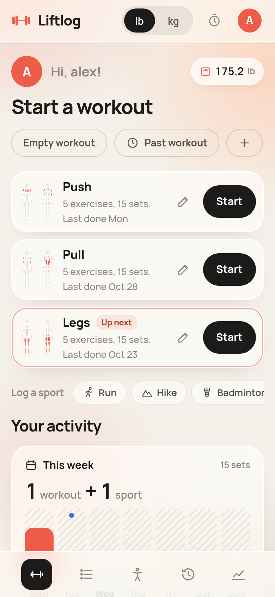
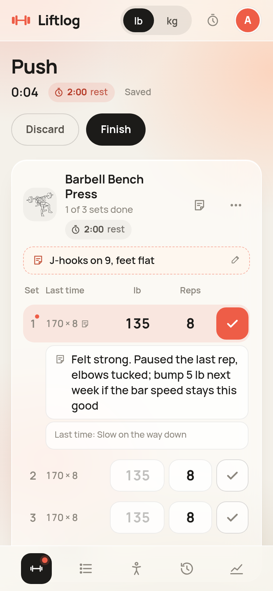
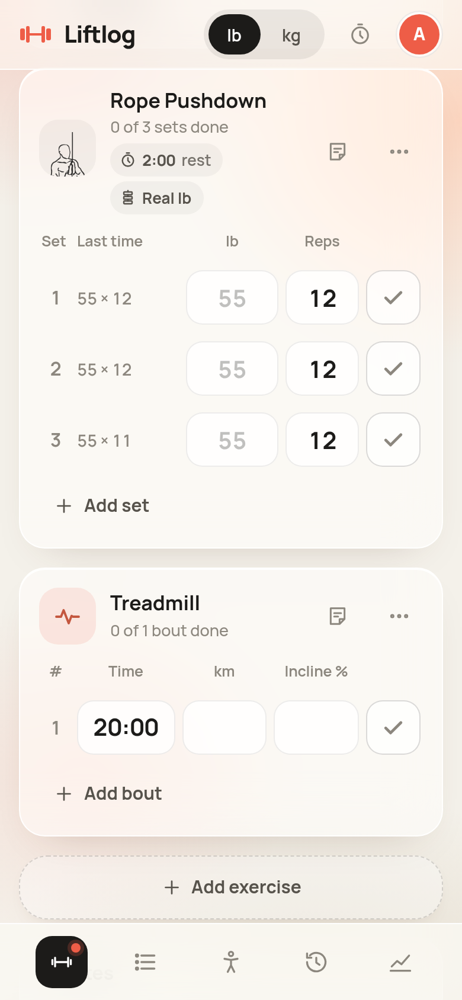
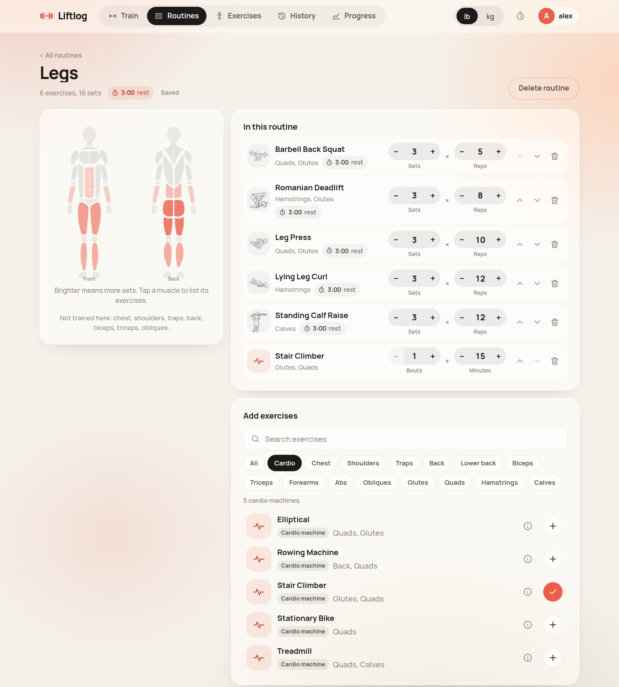
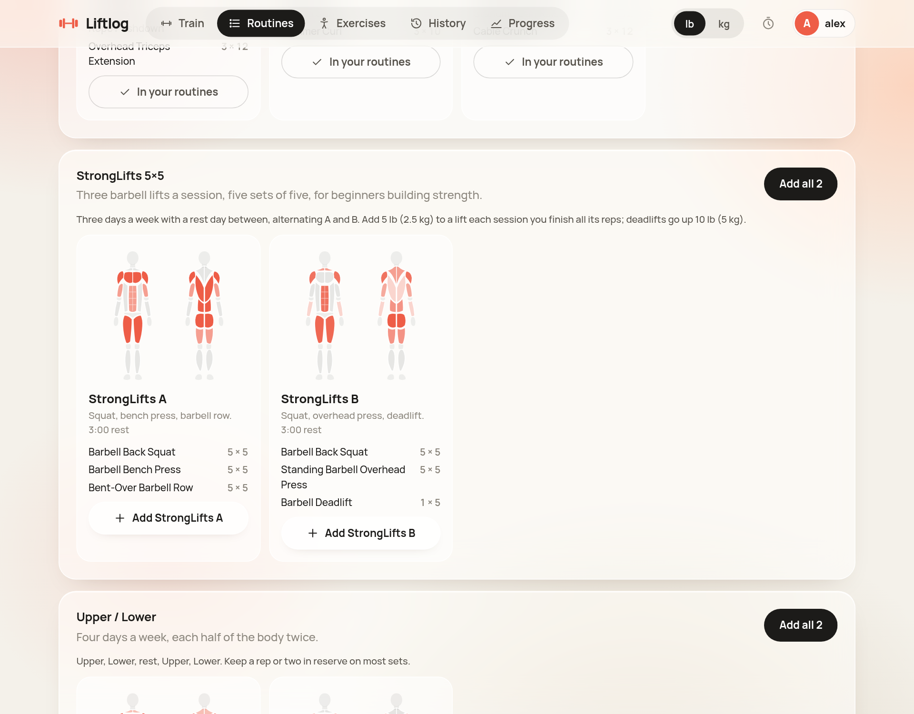
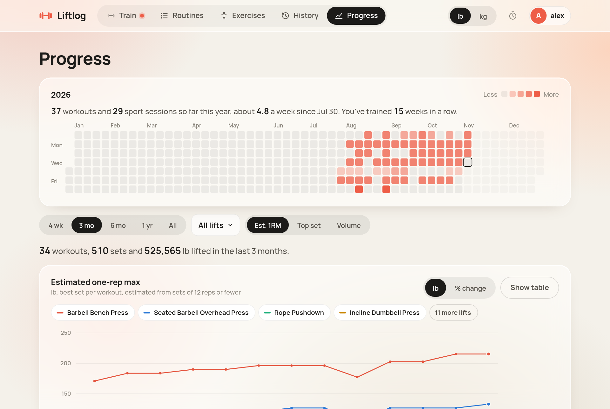
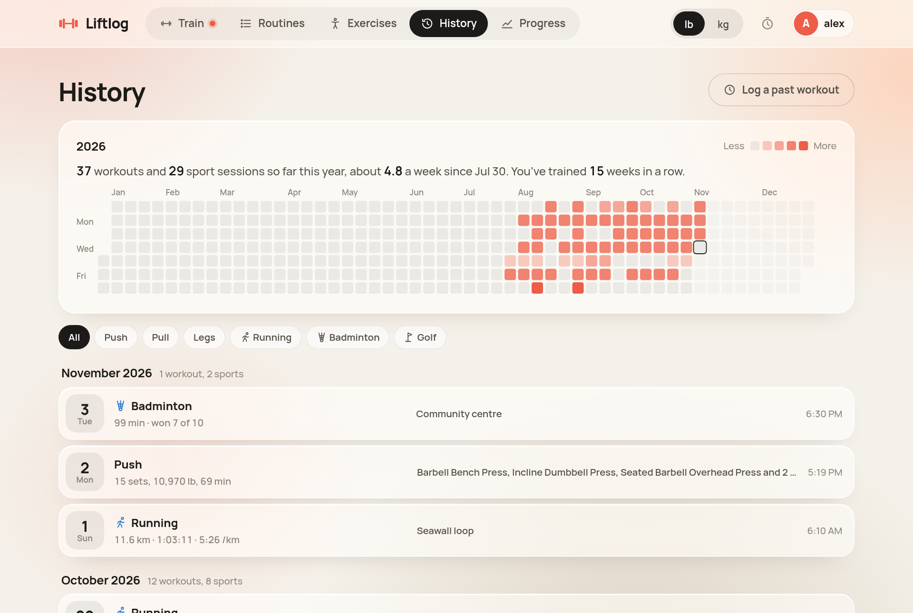

# Liftlog

A self-hosted lifting tracker. Build routines from a body map, log workouts set by set with the reps already filled in, and chart your lifts over time. Cardio machines and sports are logged too. Each person has their own account; the first account is the admin. Workouts are stored in SQLite on the server, so your phone and computer see the same log. Workout dates follow Pacific time, switching between PST and PDT automatically.

The look: warm cream with frosted-glass cards over soft colour, coral for your data, and black for whatever is selected.

## Screenshots

Taken with the sample data from [Try it with sample data](#try-it-with-sample-data).

| Start a workout | Logging, with a set note | Cardio in a workout |
| --- | --- | --- |
|  |  |  |









## Run it with Docker

On any machine with Docker and Docker Compose:

1. Copy this folder to the server, for example to `~/liftlog-next` (with `git clone`, `scp` or any SFTP client).
2. Build and start it:

```bash
cd ~/liftlog-next
docker compose up --build -d
```

3. Open `http://<server-address>:3070` and create the admin account.

Production runs as the `web` service (small standalone image, port 3070 by default). The hot-reload dev server, with your source mounted in, is behind a profile (http://localhost:3071):

```bash
docker compose --profile dev up --build dev
```

Stop everything with `docker compose --profile dev down`.

The image is multi-stage: `deps` installs packages, `build` runs `next build` with `output: "standalone"`, and `runner` ships only the compiled server as a non-root user, with a healthcheck on `/api/health`. The build needs only npm: the font and the SQLite driver come from npm packages, so nothing is fetched from Google or compiled.

### Settings

All settings have defaults. To change one, copy `.env.example` to `.env` next to `compose.yaml` and edit it, then run `docker compose up -d` again.

| Variable | Default | What it does |
| --- | --- | --- |
| `LIFTLOG_PORT` | `3070` | Host port for the app |
| `LIFTLOG_DEV_PORT` | `3071` | Host port for the dev server |
| `TZ` | `America/Vancouver` | Container time zone for logs. Workout dates always follow Pacific time |
| `PUSH_SUBJECT` | the site's HTTPS address | Contact sent with lock-screen alerts (`https://…` or `mailto:…`). Liftlog uses the address you open it on, such as `https://liftlog.example.com`, so you normally leave this out |

### Day to day

| Task | Command (in `~/liftlog-next`) |
| --- | --- |
| See if it's running and healthy | `docker compose ps` |
| Follow the log | `docker compose logs -f web` |
| Restart | `docker compose restart web` |
| Update after changing code | Upload the changed files, then `docker compose up --build -d` |
| Stop | `docker compose down` (your data stays in the volume) |

The image is built here rather than pulled, so pulling images doesn't update it; rebuilding does. Uploading new code never touches your data, which lives in the `liftlog_liftlog-data` volume, not in the folder.

## Accounts

**First visit.** With no accounts yet, Liftlog asks you to create one. That account is the admin. If the database already holds workouts or routines from before accounts existed, they become this account's.

**Adding people.** Sign-ups are closed by default. Open the menu under your avatar → **Manage users** to:

- add an account with a username and starting password (they can change it after signing in),
- make someone an admin or remove admin,
- set a new password for someone, which signs them out everywhere,
- delete an account, along with its routines and workouts,
- or switch on **Let people create their own accounts** for a while and send them the link.

Every account has its own routines, workouts, exercises and lb/kg choice; nobody sees anyone else's. There's always at least one admin, and an admin can't remove their own admin role or delete themselves.

**Sign-in details.** Passwords are hashed with scrypt. A sign-in lasts 30 days and renews while you use it. **Change password** in the avatar menu signs out your other devices. After 8 wrong passwords in 15 minutes from one address or for one username, sign-in pauses for 15 minutes. The session cookie is HttpOnly and SameSite=Lax, gets the Secure flag when the request arrived over HTTPS (as it does behind an HTTPS reverse proxy or tunnel), and writes from other websites are refused.

**Locked out?** If nobody who can sign in remembers their password, set one from the server (in the Liftlog folder):

```bash
docker compose exec web node scripts/reset-password.mjs <username> 'a new password'
```

Add `--admin` at the end to also make that account an admin.

### Remote access

Liftlog has its own login, so it can be published on the internet behind any HTTPS reverse proxy or tunnel (Caddy, nginx, Traefik, Cloudflare Tunnel and so on), pointing a hostname such as `liftlog.example.com` at port 3070. Putting an extra access layer in front (a VPN, or an identity-aware proxy such as Cloudflare Access) is still the safer choice, since it stops strangers reaching the login page at all.

HTTPS also unlocks two timer features that browsers don't allow on a plain `http://` address: keeping the screen on, and lock-screen alerts.

### Lock-screen alerts

A web page can only make a sound while it's on screen; once the phone locks, the browser freezes it. Lock-screen alerts get around that with Web Push. When a rest starts, the page tells the server when it ends. If the app isn't on screen at that moment, the server sends a push through Apple, Google or Mozilla, and the phone shows a normal notification with its usual sound. If the app *is* on screen, it beeps itself and no push is sent, so you never get both.

To turn them on, open the timer (the stopwatch in the top bar) and switch on **Lock-screen alerts** on each device. **Send a test alert** checks it end to end.

- **iPhone and iPad:** iOS 16.4 or later. Add Liftlog to the Home Screen first (Safari → Share → **Add to Home Screen**) and open it from there; Safari tabs can't receive push. The Home Screen app has its own cookies, so you sign in once inside it. If an access proxy is in front, give it a long session duration (a month, say), or the Home Screen app will ask for the email PIN every day.
- **Android:** works in a normal Chrome tab, or install it from Chrome's menu.
- **Desktop:** Chrome, Edge and Firefox work in a tab.

It uses the phone's notification sound and respects silent mode and Focus, like any app notification. Alerts usually arrive within a second; one that can't be delivered within 90 seconds is dropped rather than arriving late. The server needs outbound HTTPS to the push services (`*.googleapis.com`, `*.push.apple.com`, `*.push.services.mozilla.com`, `*.notify.windows.com`) and sends to nowhere else. Its signing keys are made on first use and kept in the database, so alerts keep working across rebuilds.

### Your data and backups

The database is `/data/liftlog.db` inside the container, on the Docker volume `liftlog_liftlog-data`. Back up that volume (or the whole host) with whatever you already use.

Two ways to take your own copy:

- In the app: avatar menu → **Download my data**, or the link at the bottom of History, gives a JSON file with your routines and workouts (weights in kg).
- From the server: `docker compose cp web:/data ./liftlog-backup` copies the whole database, every account included, with its write-ahead log.

Weights are stored in kg and converted for display, so switching between lb and kg never changes your history.

## Using it

**Train.** Your routines come first, each with a Start button, so you can begin without scrolling. The routine you did longest ago is marked **Up next**. Next to them: **Empty workout**, **Past workout** (see below), **+** for a new routine, the **Log a sport** row, and your latest bodyweight by your name (tap it to weigh in). Below, "Your activity" shows this week's workouts and sports (blue dots are sport days), your volume against the last 8 weeks, your streak in weeks (sports count), and your last workout or sport. With no routines yet, it offers the premade routines instead.

**Past workouts.** Forgot to log one? **Past workout** on Train, **Log a past workout** on History, or tap a past day on the year heatmap. Pick the day, start time and length, and a routine or an empty workout, then tick the sets you did and **Finish**. It's saved on that day, so History, the heatmap, streaks and charts all count it. While logging it the rest timer stays off, and you can still change its day, time and length at the top.

**Routines.** **My routines** lists yours; **Premade** has ready-made ones to copy in: Push / Pull / Legs, StrongLifts 5×5 (workouts A and B, five sets of five with 3:00 rest), Upper / Lower and Full body, each with how to run it week to week. Add one routine or a whole program; the copy is yours to change. Or create a routine, then tap muscles on the body map to list exercises for them and add the ones you want. Muscles fill in coral as the routine covers more sets for them, and the routine lists the muscles it doesn't touch. Tap **Cardio** above the exercise list to see the cardio machines (searching "stair stepper", "cycling" or "treadmill" finds them too); they're added as bouts × minutes. Set the sets and reps for each exercise; changes save as you go. The ⏱ chip under the routine's name sets its rest between sets, and the chip on each exercise overrides that for just that exercise (say 3:00 for squats, 1:00 for curls). Coral chips are set there; grey ones follow the level above.

**Logging.** Each exercise gets its target number of sets with the reps already filled in. Enter the weight and tap ✓:

- The faint number in the weight box is a suggestion: the set above it in this workout, or the same set last time. Tapping ✓ on an empty box uses it, so after the first set you can usually just tick.
- The *Last time* column shows what you did in that set last workout.
- Bodyweight exercises (pull-ups, dips, push-ups) take optional added weight; leave it empty for 0. Timed ones (side plank) log seconds.
- Ticking a set starts the rest timer and opens a note line under that set, for "felt easy" or "left elbow" while it's fresh. Tap any set's number to add or edit its note later. A dot on the number means it has one, and last time's note shows as a hint.
- Rest comes from the exercise, then the workout, then your default. Change either from its ⏱ chip mid-workout; the change is saved to the routine for next time.
- **Setup notes.** The note button on each exercise holds one standing note for that exercise, like "rack 7, pins 4" for squats or "seat on 3". It shows under the exercise in every workout from then on, tap it to edit, and it's also in the exercise's guide.
- **Machine stickers.** For a machine whose stack numbers aren't real weights, pick it from the stack chip under the exercise's name (Machine and Cable exercises have one; for others use **…** → *Use machine stickers*). Add the machine once with one reading you trust, e.g. the lowest number that holds you in a dead hang on the lat pulldown is your bodyweight: 175 lb = 140. **Use my bodyweight** fills in your latest weigh-in. Sets then have a **Sticker** column and show the real weight under it; charts and 1RMs use the real weight. The calculator converts either way, and machines are managed from that chip or **Exercises → Machine stickers**. Recalibrating a machine doesn't change sets already logged.
- **Cardio machines.** Treadmill, Stair Climber (stair stepper), Elliptical, Stationary Bike (cycling) and Rowing Machine log bouts instead of sets: time (type 20 for 20 minutes, or 20:30), plus distance and incline, floors and level, or metres and damper. Tapping a bout's number adds calories, average heart rate and a note. Distances follow your km/mi choice.
- Everything autosaves, so you can close the tab or switch devices mid-workout and pick it up again.
- **Finish** keeps only the sets you ticked. If you set a new best estimated 1RM on any lift, the summary says so.

**Sports.** Running, Hiking, Badminton, Pickleball and Golf are logged on their own, from **Log a sport** on Train, a day on the heatmap, or the Sports panel in Progress. Each has its own numbers, and Liftlog works out the rest:

| Sport | You enter | Liftlog adds |
| --- | --- | --- |
| Running | Time, distance, elevation gain, heart rate, effort, kind of run, route | Pace, speed |
| Hiking | Time, distance, elevation gain, heart rate, effort, trail | Pace, speed, climb per hour |
| Badminton, Pickleball | Time, singles or doubles, games played and won, effort, heart rate, where | Win rate, games lost, time per game |
| Golf | Holes, score, par, putts, fairways hit, greens in regulation, walking or cart, course; time is optional | Score to par, putts per hole, fairway %, GIR % |

Times can be typed as 1:30:00, 45:10 or just 90 (minutes). Distances are km or mi (switch in the form), elevation m or ft to match. Sports show in History next to workouts, fill heatmap squares by minutes, count toward streaks, and open with all their numbers; edit or delete from there.

**Bodyweight.** Tap the scale chip next to your name on Train: weight and a note for any day (today by default), with your recent weigh-ins and the change between them. A workout shows that day's bodyweight, and Progress charts it.

**Timer.** The stopwatch in the top bar opens a full countdown timer for anything else: presets from 30 s to 10 min or any m:ss, with pause, resume, ±15 s and reset. While it runs, a pill at the bottom of every page shows the time left, with +15, pause and stop. It survives reloads and switching tabs, and catches up instantly if the phone slept. Its settings:

| Setting | Default | What it does |
| --- | --- | --- |
| Start it when I tick a set | On | Ticking a set starts the rest timer, labelled with what's next |
| Default rest | 1:30 | Used when neither the exercise nor the routine sets one |
| Sound | On | Beeps when time's up while Liftlog is open |
| Keep the screen on | On | Stops the screen locking while a timer runs (needs HTTPS) |
| Lock-screen alerts | Off | Per device; see *Lock-screen alerts* above |

**History.** Every finished workout, newest first and grouped by month, with sets, volume and time for each. Filter by routine, or use the year heatmap at the top as a calendar: click a day, or move to it with the arrow keys and press Enter. Opening a workout shows when it started and ended, your notes, and every set (with its note) of every exercise with its estimated 1RM. The best set of each exercise is marked, and **New best** flags lifts that beat everything before that day. From there you can **Repeat this workout**, which starts a new one with the same exercises, sets and reps, or delete it.

**Exercises.** 92 common exercises with step-by-step instructions and tips: 80 strength exercises with drawings of both positions, 7 more without a drawing (such as the standing overhead press, hip thrust, face pull and plank), and 5 cardio machines. Filter by tapping the body map, by muscle, equipment or search. **Add your own** for anything missing; your own exercises have no drawing but log and chart the same way.

**Progress.**

- **The year at a glance:** a GitHub-style square for every day of the year, shaded by sets logged (1–6, 7–12, 13–20, 21+). Hover, or focus it and use the arrow keys, to see each day; click a day, or press Enter, to open its workout. Above it: workouts so far this year, your average per week, and your weekly streak. On a phone it scrolls sideways and opens on the current week.
- **Bodyweight and Sports**, at the bottom: your latest weight, 30-day change and a chart; for each sport you play, sessions, time, distance or games this year, your best, a chart of its key number (pace, distance, win rate, score to par) and the latest sessions.
- **The chart:** pick a range, a routine (or all lifts) and a measure:

| Measure | What it plots, per workout |
| --- | --- |
| Est. 1RM | Best Epley estimate, weight × (1 + reps ÷ 30), from sets of 12 reps or fewer |
| Top set | Heaviest weight lifted |
| Volume | Sum of weight × reps |

Toggle lifts with the chips above the chart (up to six). **% change** puts every lift on the same scale by measuring it against its first workout in the range, which makes a 20 lb lateral raise and a 300 lb squat comparable. Hover or use the arrow keys on the chart for exact values, or **Show table** for the numbers. Below the chart: each lift's trend, best and latest top set, and the sets each muscle got in the last 7 days.

## Try it with sample data

To see the charts before you have history, fill a separate database with three months of made-up Push / Pull / Legs workouts, plus (once the app has created its tables and you've made an account) runs, badminton, hikes and golf, weigh-ins, a lat pulldown machine and a few setup notes:

```bash
npm install
DB_PATH=./data/demo.db npm run seed:demo
DB_PATH=./data/demo.db npm run dev
```

The first account you create gets the sample workouts (or, if the database already has an admin, the seeder gives them to that admin). It refuses to write into a database that already has workouts.

## Development

```bash
npm install
npm run dev          # http://localhost:3000, database in ./data/liftlog.db
```

Or with Docker and hot reload: `docker compose --profile dev up --build dev` (http://localhost:3071, database in `./data/dev.db`).

### API

Everything except `/api/auth/*` and `/api/health` needs a signed-in session cookie, and only ever touches that account's data. Writes must be JSON (`Content-Type: application/json`).

| Method and path | Does |
| --- | --- |
| `POST /api/auth/setup` | `{ username, password }`: creates the admin; only while there are no accounts |
| `POST /api/auth/login`, `POST /api/auth/logout` | Start or end a session |
| `POST /api/auth/signup` | `{ username, password }`: only while an admin has sign-ups open |
| `PUT /api/account/password` | `{ current, next }` |
| `GET /api/bootstrap` | Your account, settings, routines, exercises, workout in progress, workout list and every completed set |
| `PUT /api/settings` | `{ unit: "lb" \| "kg", distanceUnit: "km" \| "mi", restSec, restAuto, timerSound, keepAwake }` |
| `POST /api/routines`, `PUT/DELETE /api/routines/:id` | `{ name, restSec, items: [{ exerciseId, sets, reps, restSec }] }`. `restSec` is 5–3600 seconds, or null to follow the level above |
| `POST /api/sessions` | Start a workout: `{ routineId }`, `{ fromSessionId }` to repeat a past one, or `{ name }` for an empty one. Returns the one in progress if there is one |
| `GET /api/sessions/:id` | One workout with all its sets and notes |
| `PUT /api/sessions/:id` | Autosave: `{ name, notes, restSec, exercises: [{ exerciseId, restSec, sets: [{ reps, weightKg, done, note, x }] }] }`. `x` holds a machine's sticker number or a cardio bout's `km`, `m`, `incline`, `level`, `floors`, `cal`, `hr`; for cardio, `reps` is the time in seconds |
| `POST /api/sessions/:id/finish` | Keep ticked sets and close the workout; discards it if nothing was ticked |
| `DELETE /api/sessions/:id` | Discard or delete a workout |
| `POST /api/exercises`, `DELETE /api/exercises/:id` | Your own exercises |
| `GET /api/export` | Your data as a JSON download |
| `GET/POST /api/admin/users`, `PUT/DELETE /api/admin/users/:id` | Admins: list, add, change role or password, delete |
| `PUT /api/admin/settings` | Admins: `{ signupOpen }` |
| `POST /api/sessions` with `{ at, pastMin }` | A workout logged afterwards: `at` is when it started, `pastMin` its length. `PUT /api/sessions/:id` then also takes `startedAt` and `pastMin` |
| `PUT /api/exercise-prefs/:exerciseId` | `{ note, machineId }`: your setup note and the machine whose stickers it uses |
| `POST /api/machines`, `PUT/DELETE /api/machines/:id` | `{ name, realKg, sticker }`: the stack reading `sticker` really weighs `realKg` |
| `PUT /api/bodyweight/:date` | `{ kg, note }` for that day; both empty removes it |
| `GET/POST /api/activities`, `GET/PUT/DELETE /api/activities/:id` | Sports: `{ sport, startedAt, durationSec, distanceKm, data, notes }`; `data` holds the sport's fields, as listed in `lib/sports.ts` |
| `GET /api/push`, `POST/DELETE /api/push` | The server's public push key; turn lock-screen alerts on or off for a browser (`{ endpoint, keys }`) |
| `POST /api/push/test` | `{ endpoint }`: send that browser a test alert now |
| `PUT /api/timer` | `{ endpoint, endAt, title, label, hidden, seq }`: the page keeps the server in step with its timer; `seq` makes late updates harmless |
| `GET /api/health` | Database check, used by the container healthcheck |

### Project layout

```
app/
  page.tsx            picks first-run setup, sign-in or the app
  api/…               route handlers (validation in lib/server/validate.ts)
  layout.tsx          Manrope variable font (from npm), metadata
  globals.css         all styles: tokens, glass, body map, logger, chart, heatmap
components/
  App.tsx             shell: top bar, tabs, unit toggle, toasts
  Timer.tsx           countdown timer: pill, sheet, settings, sound, wake lock, alerts
  RestSelect.tsx      the ⏱ rest chip
  AuthScreen.tsx      setup, sign in, sign up
  Account.tsx         avatar menu, change password, Users panel
  Activity.tsx        "Your activity" cards on the Train tab
  TrainView.tsx       start rows, templates, finish summary
  HistoryView.tsx     every finished workout, by month
  WorkoutDialog.tsx   one workout in full: sets, notes, bests, repeat
  Logger.tsx          a workout in progress: autosave, rest, past-workout times
  ExerciseBlock.tsx   one exercise's sets: weights, stickers, cardio bouts, notes
  SetupNote.tsx       the standing note on an exercise
  Machines.tsx        machine sticker presets and calculator
  Sports.tsx          log, view and edit a sport; the Log a sport row
  BodyWeight.tsx      bodyweight chip and dialog
  PastWorkout.tsx     log a workout that already happened
  DayDialog.tsx       one day from the heatmap, with ways to log for it
  MoreProgress.tsx    bodyweight and sports panels on Progress
  RoutinesView.tsx    routine list and editor (body map + picker)
  ExercisesView.tsx   exercise library and "Add your own"
  GuideDialog.tsx     exercise guide: drawings, muscles, steps, tips
  ProgressView.tsx    filters, chart, lifts, weekly muscles
  YearHeatmap.tsx     the year of training, one square per day
  LineChart.tsx       SVG line chart with crosshair tooltip, sparkline
  BodyMap.tsx         front/back figure with clickable muscles
lib/
  exercises.ts        the 92 built-in exercises (5 cardio machines) and their guides
  sports.ts           the sports, their fields and worked-out numbers
  bodyMap.ts          body map geometry
  stats.ts            1RM, series, previous sets, sets per muscle
  time.ts             Pacific dates
  units.ts            lb ⇄ kg
  push.ts             lock-screen alerts in the browser
  server/db.ts        SQLite connection and migrations
  server/auth.ts      passwords, sessions, accounts, sign-in limits
  server/repo.ts      all reads and writes, per account
  server/push.ts      push keys, subscriptions, the alarm loop
instrumentation.ts    starts the alarm loop with the server
public/sw.js          service worker that shows pushed alerts
public/manifest.webmanifest  Home Screen install
public/ex/            exercise drawings (see CREDITS.md)
scripts/
  seed-demo.mjs       sample data
  reset-password.mjs  set a password from the command line
```

To add a built-in exercise, add an entry to `lib/exercises.ts` and two drawings as `public/ex/<id>-a.webp` and `<id>-b.webp`. The drawings are stored as white line art and shown dark through a CSS filter.

Chart colours are a categorical palette checked for colour-blind separation on the light glass; each lift keeps its colour while it's switched on, and the legend, tooltip and table carry the values for the two lighter colours.

## Credits

Exercise drawings: [Everkinetic](https://github.com/everkinetic/data) by Greg Priday, CC BY-SA 4.0, recoloured for this app (details in `public/ex/CREDITS.md`). Font: Manrope by Mikhail Sharanda, SIL Open Font License.
